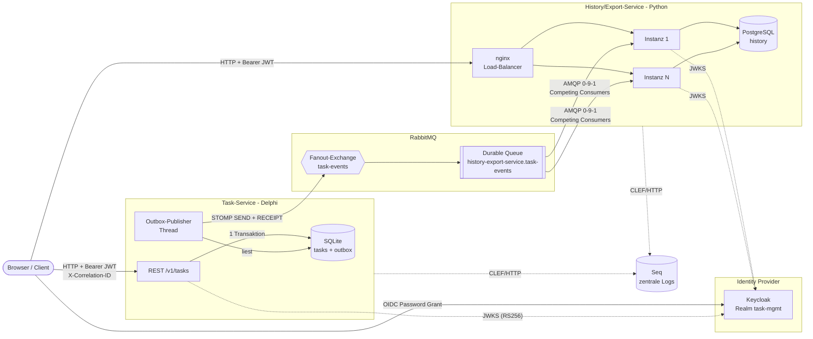
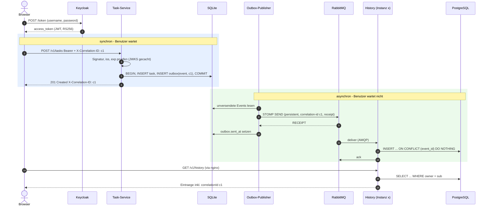
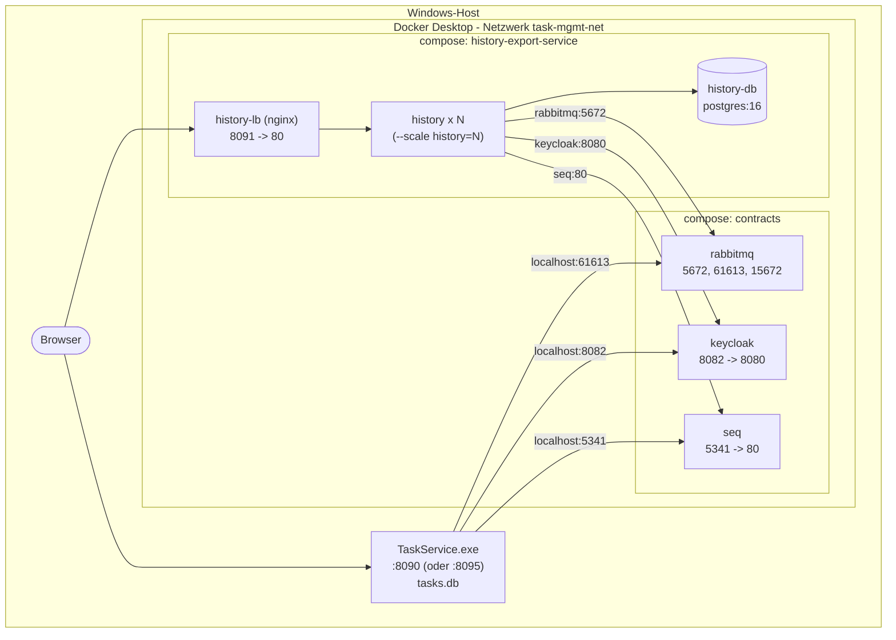

# Architektur - Task-Management-System

Zwei unabhaengig entwickelte und deployte Services, verbunden ueber formale
Vertraege (dieses Repo) und einen Message-Broker. Die Diagramme sind
Mermaid und werden auf GitHub direkt gerendert.

## 1. Ueberblick: Services, Grenzen, Protokolle

| Komponente | Verantwortung | Besitzt Daten | Vertrag |
| --- | --- | --- | --- |
| **Task-Service** (Delphi) | Aufgaben anlegen/aendern/loeschen, Ownership pruefen, Events publizieren | `tasks`, `outbox` (SQLite) | `openapi/task-service.yaml` (Provider), `asyncapi/task-events.yaml` (Publisher) |
| **History/Export-Service** (Python) | Events konsumieren, History pro Benutzer, Export JSON/CSV | `history` (PostgreSQL) | `openapi/history-export-service.yaml` (Provider), `asyncapi/task-events.yaml` (Consumer) |
| **Keycloak** | Login, Ausstellen signierter Access-Tokens (RS256) | Benutzer | OIDC |
| **RabbitMQ** | Entkopplung, Puffern von Events, Protokoll-Bruecke STOMP <-> AMQP | Nachrichten in Queues | - |
| **Seq** | Zentrale Log-Suche ueber alle Services per Korrelations-ID | Logs | CLEF |

Grenzen: Die Services teilen **keinen** Code, **keine** Datenbank und rufen
sich **nicht** gegenseitig auf. Einzige Kopplung sind die Vertraege in diesem
Repo. Jede Datenbank gehoert genau einem Service (Database per Service).

## 2. Datenfluss: synchron + asynchron

Die Korrelations-ID `c1` steht dabei in jedem Log-Eintrag beider Services
(Request-Log, "Aufgabe angelegt", "Event published", "Event verarbeitet")
und laesst sich in Seq mit `correlationId = 'c1'` als durchgehende Spur
anzeigen.

## 3. Fehlerbehandlung

| Ausfall / Fehler | Verhalten | Ergebnis |
| --- | --- | --- |
| **RabbitMQ down** | Task-Service speichert Aenderung + Event trotzdem (Outbox). Publisher versucht es mit Backoff 1 s -> 30 s erneut. | Request unverzoegert (gemessen ~10-400 ms), Event wird nachgeliefert |
| **Broker bestaetigt nicht** (Verbindungsabbruch nach SEND) | Kein RECEIPT -> Event bleibt in der Outbox -> erneuter Versand | Moegliches Duplikat -> beim Consumer verworfen |
| **History-Service komplett down** / Deployment | Events bleiben in der durable Queue liegen | Nachlieferung nach Start, Task-Service merkt nichts |
| **Eine History-Instanz stirbt mitten in der Verarbeitung** | Nicht bestaetigte Nachricht geht an eine andere Instanz | Keine Verluste; nginx leitet HTTP an andere Instanz weiter |
| **Doppelt zugestelltes Event** | Primary Key `event_id` -> `ON CONFLICT DO NOTHING`, ack | Genau ein Eintrag (idempotent) |
| **PostgreSQL down** | Consumer: nack + requeue (Retry). API: `503` statt Timeout | Keine Verluste, sauberer Fehler fuer den Client |
| **Ungueltiges Event** (kein JSON, Pflichtfeld fehlt) | Geloggt (Warning) + ack | Blockiert die Queue nicht (kein Poison-Loop) |
| **Unbekannte `schemaVersion` / `eventType`** | Tolerant Reader: uebersprungen + geloggt | Alte Consumer brechen nicht bei neuen Publishern |
| **Keycloak down** | Gecachte JWKS -> bestehende Tokens funktionieren weiter; Login nicht moeglich; History antwortet `503` wenn JWKS fehlt | Graceful Degradation |
| **Token manipuliert / `alg: none` / abgelaufen** | Signatur- bzw. Claim-Pruefung schlaegt fehl | `401` |
| **Seq down** | Logs werden verworfen, stdout bleibt | Kein Einfluss auf Requests |

## 4. Deployment-Topologie

- Start/Stop des Gesamtsystems: `start-all.ps1` / `stop-all.ps1` in diesem Repo.
- Der Task-Service laeuft als Windows-Prozess, weil der Delphi-Linux-Compiler
  nicht verfuegbar ist (siehe README "Containerisierung").
- Persistente Daten: Docker-Volumes `history-db-data`, `rabbitmq-data`,
  `seq-data`, sowie `tasks.db` im Delphi-Repo-Ordner.

## 5. Skalierung

- **History-Service**: zustandslos (Daten in PostgreSQL), horizontal
  skalierbar mit `docker compose up -d --scale history=N --no-recreate`.
  nginx loest den Service-Namen alle 5 s neu auf (Docker-DNS) und verteilt
  Round-Robin - neue Instanzen bekommen ohne Neustart Traffic. Alle Instanzen
  sind Competing Consumers derselben Queue (Prefetch 10).
- **Task-Service**: eine Instanz (SQLite). Der Code haelt keinen Zustand im
  Speicher; fuer mehrere Instanzen muesste nur die DB auf einen Server
  wechseln. Die Outbox ist dafuer bereits geeignet (Versand per eventId
  idempotent).

## 6. Sicherheit

- OIDC/OAuth2 ueber eigenen Identity Provider (Keycloak), Realm als Code
  (`keycloak/task-mgmt-realm.json`).
- Beide Services pruefen Tokens **unabhaengig** und vollstaendig: Signatur
  RS256 gegen die JWKS (Key-Rotation: Neu-Laden bei unbekanntem `kid`),
  Issuer, Ablaufzeit. Kein gemeinsamer Session-State.
- Autorisierung ressourcenbasiert ueber den `sub`-Claim: fremde Aufgaben
  liefern `404`, fremde History-Eintraege werden nie ausgeliefert.
